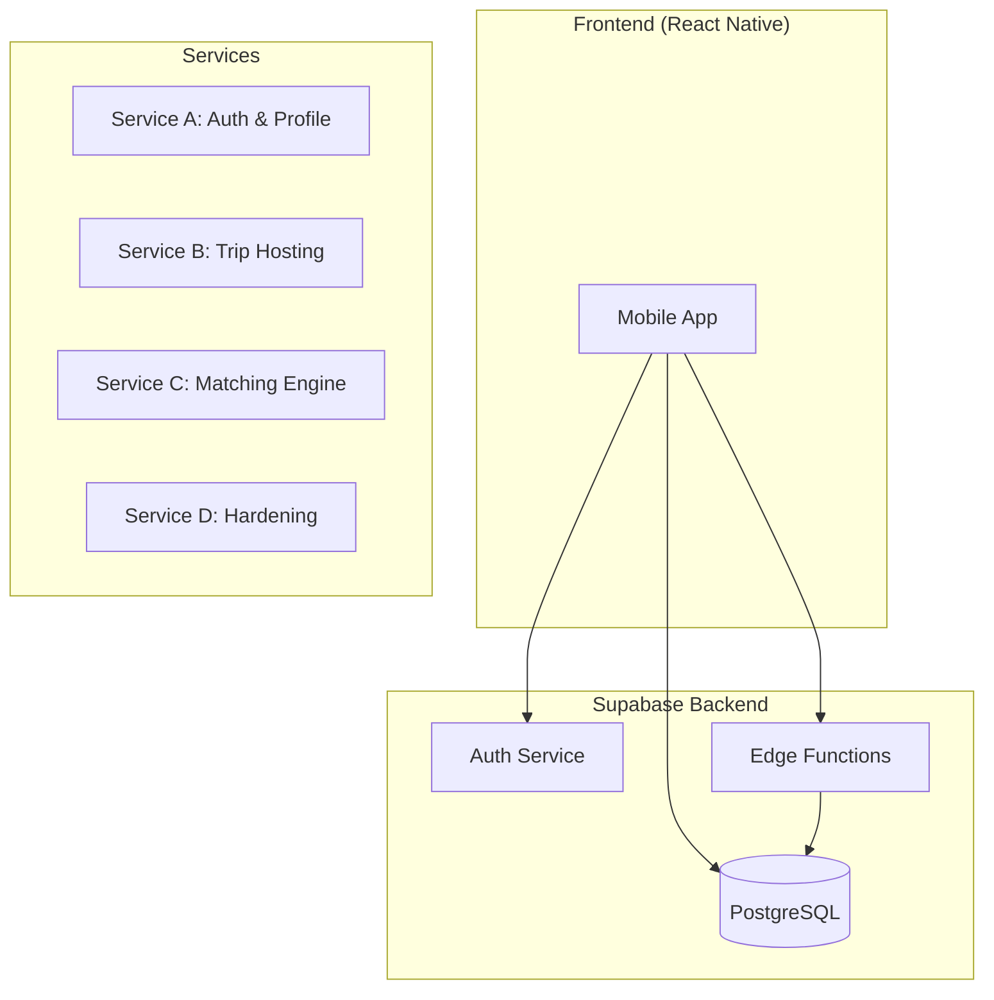

# GoTogether — System Architecture

## Overview

GoTogether is a social travel matching app built with:
- **Frontend**: React Native (Expo)
- **Backend**: Supabase (Postgres + Edge Functions)
- **Auth**: Supabase Auth (Email/Password, OAuth)

---

## Service Architecture



---

## Service Boundaries

| Service | Responsibility | Tables |
|---------|---------------|--------|
| **A** | Auth, profiles, user tags | `profiles`, `user_tags` |
| **B** | Trip CRUD, participants, trip tags | `trips`, `trip_participants`, `trip_tags` |
| **C** | Match scoring (read-only) | None (Edge Function) |
| **D** | Security, rate limits, docs | `rate_limits` |

---

## Data Flow

### User Registration
```
1. User signs up → Supabase Auth
2. Trigger creates profile (trust_score = 50)
3. User selects ≥3 tags → user_tags
4. Redirect to home
```

### Trip Creation
```
1. Host creates trip → trips table
2. Host sets include/exclude tags → trip_tags
3. If trust_score ≥ 30 → status = 'active'
4. Otherwise → status = 'draft'
```

### Trip Matching
```
1. User requests feed → Edge Function
2. Fetch user tags + active trips
3. Calculate scores (tags, budget, date, location)
4. Filter out excluded trips (hard filter)
5. Return sorted by match %
```

---

## Security Measures

| Protection | Implementation |
|------------|----------------|
| Row-Level Security | All tables have RLS policies |
| Trust Score | Server-side only, no client updates |
| Exclude Tags | Hidden from non-hosts via RLS |
| Trip Overlap | Server-side trigger validation |
| Rate Limiting | rate_limits table + check functions |

---

## Environments

| Environment | Purpose |
|-------------|---------|
| `dev` | Local development |
| `staging` | Pre-production testing |
| `prod` | Production |

---

## Deployment

### Edge Functions
```bash
supabase functions deploy get-matched-trips
```

### Migrations
```bash
supabase db push
```

### Mobile App
```bash
cd mobile
npx expo start
```
